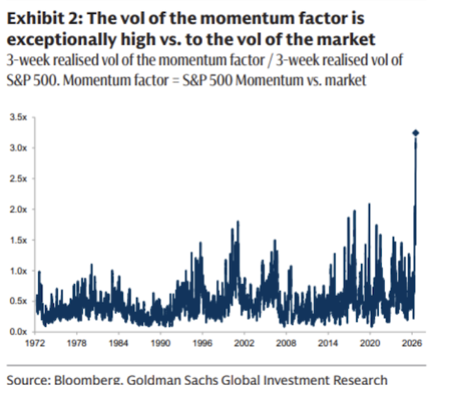
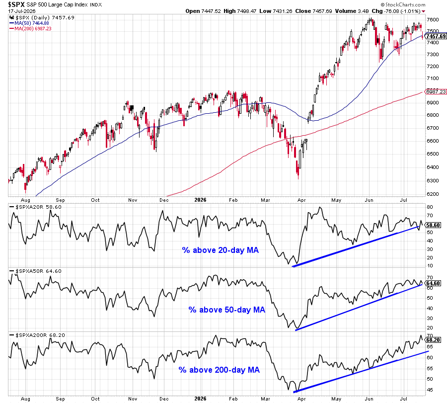
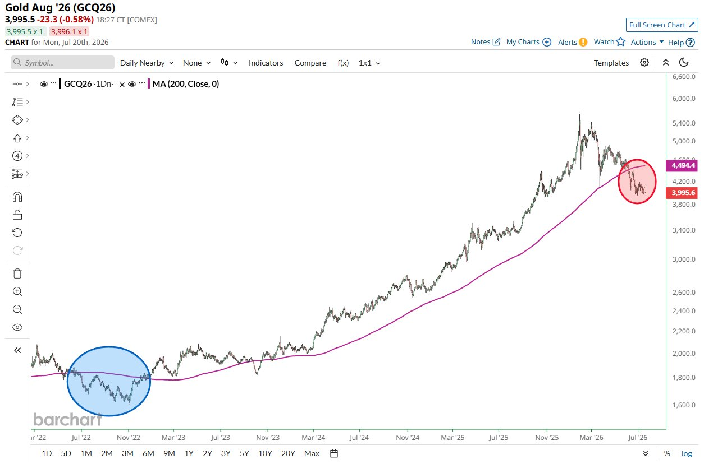
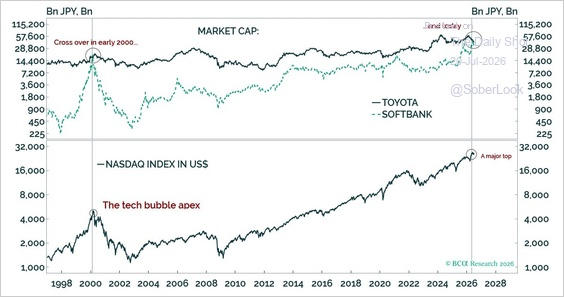
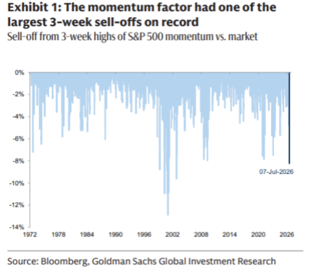
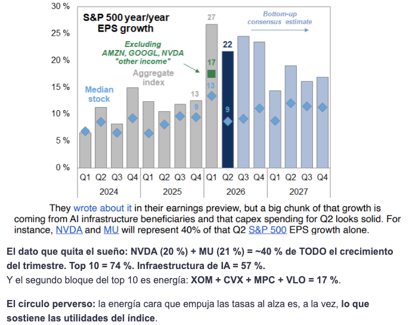
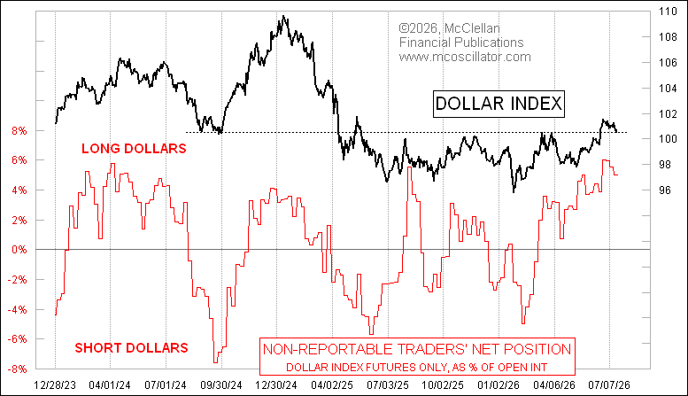
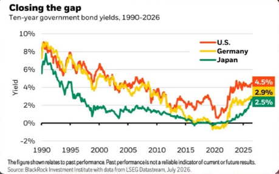

# The index holds up, but the market underneath has already changed

Earnings, rotation, the dollar and AI’s real test.

- Edition: Second report of July 2026
- Author: Luigui Herrera
- Original publication: 2026-07-20
- Last editorial update: 2026-07-20
- Editorial cutoff: 2026-07-17
- Market data cutoff: 2026-07-18
- English edition: https://www.luiguiherrera.com/en/reports/second-july-2026
- Spanish original: https://www.luiguiherrera.com/informes/segundo-informe-julio-2026

## Main thesis

The S&P 500 retains its medium- and long-term structure, but a violent rotation took place beneath the index. Individual stocks are moving much more than the aggregate market: some rise while others fall, and the index hides part of that internal change.

## Executive summary

- **VOO:** The index is holding up, but no longer explains internal dispersion well.
- **GLD:** Gold remains weak in price while retaining its structural role.
- **EWJ:** Japan retains relative strength, with technology, the yen and rates carrying more weight.
- **FXI:** China remains tactical: low valuations are not enough without a catalyst.
- **BTC / ETH:** Crypto behaved as high beta again, rather than a defensive hedge.
- **Stockpicking:** Dispersion creates opportunities, but also penalizes duplicated factor exposure.

### Cross-market factor: DXY / USD/COP

The dollar retains support, although long positioning looks crowded and USD/COP has its own domestic drivers.

## Context by asset

### VOO / S&P 500

**The index held up, but internal volatility increased.**

The index held up better than its former leaders. The correction centered on momentum, stocks that had been rising on inertia and recent leadership, semiconductors and AI infrastructure, without indiscriminate selling. Around 68% of constituents remain above their 200-day moving average, suggesting still-reasonable structural breadth, although short-term breadth deteriorated, especially in technology. Individual-stock volatility is near extreme levels and index correlation is approaching historical lows: some stocks rise while others fall. Earnings season will be the next catalyst.

### GLD

**Gold’s technical weakness is real.**

Gold has spent more than 30 sessions below its 200-day moving average, its longest streak since 2022. It did not provide shelter during the momentum correction because a firm dollar, high yields and weak systematic positioning pressured prices. The weakness is technical and real, rather than an isolated fluctuation. Even so, its structural diversification role does not depend on leading every week. SLV serves only as a comparison: silver combines monetary sensitivity with the industrial cycle. JNUG must be considered separately: it is a tactical, leveraged instrument rather than a structural gold position.

### EWJ

**Japan retains relative strength with more concentrated leadership.**

Japan retains relative strength among developed markets, with leadership more concentrated in technology, investment and AI-related assets. SoftBank surpassed Toyota by market capitalization for the second time in the series shown; the first coincided with the 2000 technology bubble. The comparison warns of narrative concentration, rather than automatically predicting a collapse. Meanwhile, Japanese yields are approaching those of Germany and the United States, making monetary normalization and the yen relevant again. EWJ retains yen exposure; HEWJ helps illustrate how currency hedging can change the reading.

### FXI

**China remains tactical and still lacks its own leadership.**

Institutional managers reduced emerging-market exposure and China has yet to regain sustained leadership. Low valuations have not attracted consistent flows. FXI retains a tactical, contrarian character: it can diversify US concentration, but needs its own catalysts to become more than a cheap story.

### BTC / ETH

**Crypto behaved as high beta again.**

BTC and ETH behaved as high-beta assets, tending to amplify risk appetite both upward and downward. They did not function as cash or defensive hedges during the technology and momentum correction. Dollar strength reduced risk appetite and reminded us that crypto still depends on liquidity, flows, rates and DXY. BTC generally retains greater relative strength; ETH may be more sensitive to deleveraging and narrative changes.

### Stockpicking

**Dispersion increases opportunities and concentration mistakes alike.**

High dispersion, meaning large differences between winners and losers, favors active selection but also raises the risk of large losses in individual stocks. Low correlation allows different companies to produce very different results. The momentum correction showed that seemingly distinct positions can depend on the same factor: US semiconductors, Taiwan, Korea, AI and high beta can be one bet disguised as diversification. Earnings season shifts the focus from expectations to sales, margins, guidance provided by management, returns on CapEx or capital expenditure, financing and the ability to turn AI into earnings.

### DXY and USD/COP

**The dollar retains support, but positioning is crowded.**

CTAs, systematic strategies that often follow trends, and non-reportable traders hold large dollar longs. USD long positioning is crowded, although DXY, which measures the dollar against a basket of developed-market currencies, retains support from yields, rates and defensive demand. After CPI and PPI, scenarios involving slightly lower rates gained weight, and yield convergence among the United States, Germany and Japan could reduce some of the dollar’s relative advantage. USD/COP does not track DXY one for one: oil, global risk, emerging-market flows, Colombian rates, fiscal conditions and domestic political risk also matter.

## Follow-up reading by asset

### VOO / S&P 500

**The index is not broken, but its calm does not reflect what is happening beneath it.**

Classification: **core**

- **What happened:** The S&P 500 held up better than momentum, semiconductors and AI infrastructure. Selling was not indiscriminate: structural breadth remains reasonable, while short-term technology breadth deteriorated.
- **What changed:** Low correlation means the index combines opposing moves. It can look calm despite violent rotation beneath the surface.
- **What I expect:** Base case: a constructive but more volatile and selective market. The index can remain firm if earnings support expectations and correlation stays low.
- **What to watch:** Main risk: AI, inflation or rate disappointments raise correlation and transmit volatility currently concentrated in individual stocks to the index. Watch 20-, 50- and 200-day breadth, VIX, implied correlation, large technology companies, the T+3 to T+5 reaction and systematic selling.
- **Report reading:** VOO retains its core role. Index stability should not be confused with an absence of internal risk.
- **Before / context:** Leadership rested on technology, AI, momentum and flows.
- **Now / change:** The index holds up, but former leaders correct and dispersion increases.
- **Next signals:** Earnings and breadth will show whether rotation is healthy or beginning to affect the index.

### GLD

**Gold is experiencing genuine technical weakness.**

Classification: **diversifier**

- **What happened:** GLD has spent an extended period below its 200-day moving average. A firm dollar, elevated yields and weak systematic positioning explain the pressure.
- **What changed:** Gold did not act as a haven during the momentum correction, making it necessary to distinguish its structural role from its weekly behavior.
- **What I expect:** Base case: GLD may remain weak while DXY and real yields, meaning inflation-adjusted rates, stay elevated. Positive signal: recovery of the 200-day average, a weaker dollar or easing real yields.
- **What to watch:** Main risk: further technical deterioration and continued systematic outflows. Watch the 200-day average, real yields, the dollar and GLD flow-pressure readings.
- **Report reading:** GLD diversification and tactical trading in JNUG are distinct considerations. JNUG should not be treated as equivalent to a structural gold position.
- **Before / context:** GLD acted as a regime diversifier.
- **Now / change:** Technical pressure dominates and leveraged products amplify short-term moves.
- **Next signals:** Recovery of the long-term moving average would be the first substantial improvement.

### EWJ

**Japan remains strong, but its leadership is also becoming concentrated.**

Classification: **international**

- **What happened:** Japan retains relative strength among developed markets. Leadership shifted toward technology, investment and AI-related assets, with the SoftBank/Toyota comparison warning of narrative concentration.
- **What changed:** Monetary normalization and the yen return to the center of attention as Japanese yields approach German and US yields.
- **What I expect:** Base case: a favorable bias while Japan retains relative strength. Positive signal: broader leadership and an orderly yen.
- **What to watch:** Main risk: technology concentration, monetary normalization, abrupt yen movements and profit-taking. EWJ retains yen risk; currency hedging reduces much of that exposure.
- **Report reading:** Distinguish Japanese equity returns from currency returns. Unhedged and hedged exposure do not produce the same result.
- **Before / context:** Japan had been leading developed Asia.
- **Now / change:** Leadership is concentrating and the yen matters again.
- **Next signals:** Relative strength and monetary policy will determine the reading.

### FXI

**China remains tactical: low valuations are not enough without a catalyst.**

Classification: **contrarian**

- **What happened:** Reduced emerging-market exposure and a lack of sustained leadership keep FXI in a lagging-market reading.
- **What changed:** The market continues to demand more than low multiples: it needs flows, confidence and improving earnings.
- **What I expect:** Base case: tactical performance dependent on catalysts. Positive signal: credible stimulus, recovering confidence, improving flows and relative strength.
- **What to watch:** Main risk: remaining cheap without buyers or earnings growth. Watch Chinese data, the dollar, emerging-market flows and policy responses.
- **Report reading:** FXI can diversify US concentration but has yet to establish its own leadership.
- **Before / context:** Underperformance offered a contrarian hypothesis.
- **Now / change:** The lack of consistent flows sustains caution.
- **Next signals:** Only clear catalysts would change the reading.

### BTC / ETH

**Crypto remains high beta, sensitive to liquidity, the dollar and technology.**

Classification: **high beta**

- **What happened:** BTC and ETH did not act as cash or defensive hedges. The technology and momentum correction, together with dollar strength, reduced risk appetite.
- **What changed:** The reading again distinguishes spot prices from flows and narrative. BTC tends to retain greater relative strength; ETH can be more sensitive to deleveraging.
- **What I expect:** Base case: high sensitivity to liquidity, the dollar and risk appetite. Positive signal: weaker DXY, lower rates, stabilizing momentum and returning flows.
- **What to watch:** Main risk: deleveraging, a strong dollar and a widening technology correction. Watch BTC spot, ETH spot, VIX, DXY and financial conditions.
- **Report reading:** Do not treat them as defensive assets. They work better as indicators of beta and liquidity.
- **Before / context:** Liquidity supported crypto appetite.
- **Now / change:** Beta to technology becomes visible again.
- **Next signals:** The dollar, rates and momentum will determine the rebound’s stability.

### Stockpicking

**Selection matters more, but position sizing matters even more.**

Classification: **key**

- **What happened:** High dispersion favors active selection: different companies can deliver very different outcomes. It also increases the risk of large individual-stock losses. Owning five different stocks offers little protection if all five depend on the same story.
- **What changed:** The momentum correction showed that US semiconductors, Taiwan, Korea, AI and high beta can represent a single bet. Earnings will shift attention toward sales, margins, guidance, returns on CapEx, financing and the ability to turn AI into earnings.
- **What I expect:** Base case: more individual opportunities and less value in buying whole sectors without filters. Priorities: real earnings, defensible margins, company-specific catalysts, balance sheets, financing, guidance and position sizing.
- **What to watch:** Risks: duplicating factors, buying before earnings without a margin of safety, interpreting every decline as an opportunity, depending on one narrative and chasing momentum rebounds before confirmation. For AI and semiconductors, watch capex and margins; for financials, credit and provisions; for healthcare, guidance and regulation; for industrials and infrastructure, backlog and costs; for consumer businesses, demand and pricing power.
- **Report reading:** Expected aggregate EPS growth is around 22%, but the median stock would be near 9%. AI infrastructure would explain around 60% of growth; MU and NVDA more than 40%, and the ten largest contributors around 75%. The useful reaction often emerges between T+3 and T+5, rather than necessarily on day one.
- **Before / context:** The index allowed some dispersion to be overlooked.
- **Now / change:** Dispersion exposes common dependencies and diversification mistakes.
- **Next signals:** Earnings will separate solid narratives from vulnerable momentum.

### DXY and USD/COP

**The dollar continues to diversify peso exposure, but positioning is crowded.**

Classification: **currency**

- **What happened:** DXY retains support from yields, rates and defensive demand. Meanwhile, CTAs and non-reportable traders hold large dollar longs, signaling crowded positioning.
- **What changed:** After CPI and PPI, scenarios involving slightly lower rates gained weight. Yield convergence among the United States, Germany and Japan could reduce part of the dollar’s relative advantage.
- **What I expect:** Base case: a still-firm dollar, with growing reversal risk from positioning. It could strengthen if the Fed remains restrictive, yields rise or risk appetite falls; it could weaken if inflation moderates, the Fed becomes less hawkish, yields fall or longs are closed.
- **What to watch:** For USD/COP, also consider oil, Colombian risk, emerging-market flows and domestic fiscal and monetary policy. DXY and USD/COP do not always move one for one.
- **Report reading:** Dollar exposure continues to diversify against the Colombian peso, but crowded positioning increases the risk of a rapid dollar correction.
- **Before / context:** The dollar offered protection and a relative yield advantage.
- **Now / change:** Support persists, but the long consensus looks fuller.
- **Next signals:** Inflation, the Fed, oil and domestic risk will determine USD/COP.

## Automatic readings at the report cutoff

Frozen historical snapshot. Data through **2026-07-18**. The figures reproduce the published state and do not represent current data.

### Regime at cutoff

| Field | Value |
| --- | --- |
| Regime | Caution |
| Score | 36/100 |
| Confidence | 58% |
| Bias | cautious |
| Historical interpretation | Several market readings are deteriorating, but evidence is still insufficient to classify the regime as stress. Current weighting: sector rotation 45%, VIX 40%, BTC ETF flows 15% and FedWatch 0% while pending. |

#### What helped

- Rotation: mixed rotation; an extremely defensive reading does not dominate.
- BTC ETF flows: mixed flows contribute a neutral reading.

#### What weighed

- Rotation: defensives lead while growth/cyclicals remain weak.
- Volatility: watchfulness; in the watch zone.
- VIX momentum: VIX rising quickly; caution increases.

#### What to watch

- VIX curve: moderate contango.
- BTC ETF flows: mixed flows.
- The reading suggests mixed rotation. It does not imply a future market direction.

### Main indices through ETFs

| Ticker | 1W return | Long-term average | Distance from highs |
| --- | ---: | ---: | ---: |
| SPY | -0.8% | +7.2% | -1.9% |
| QQQ | -2.3% | +8.7% | -6.7% |
| DIA | -0.7% | +7.4% | -1.7% |
| IWM | +0.2% | +12.0% | -2.1% |

### Sector rotation

- Positive sectors: **5 / 11**
- Negative sectors: **6**
- 1W dispersion: **+2.6%**
- Reading at publication: the reading suggests mixed rotation. It does not imply a future market direction.

| Group | Ticker | Name | 1W return |
| --- | --- | --- | ---: |
| Leader | XLU | Utilities | +1.2% |
| Leader | XLP | Consumer staples/defensive | +0.9% |
| Leader | XLV | Health care | +0.7% |
| Laggard | XLK | Technology | -1.4% |
| Laggard | XLY | Consumer discretionary | -0.8% |
| Laggard | XLE | Energy | -0.5% |

### VIX — volatility at cutoff

| Field | Value |
| --- | --- |
| Level at cutoff | 18.8 |
| 1D change | +2.0 |
| Status | Attention / Watchfulness |
| Momentum | Rising quickly |
| Curve | Moderate contango |
| Historical reading | Longer-dated contracts trade above the nearest expiry. This structure is common in more orderly volatility environments. |

### BTC ETF net flows at cutoff

- Latest day: **+124 M USD**
- Rolling 5D: **-228 M USD**
- Streak: **Inflow streak**
- Reading at publication: recent flows have no clear dominant direction.

### Historical GLD flow-pressure proxy

- Data date: **2026-07-17**
- Proxy at cutoff: **Likely net outflow**
- 5D change in shares outstanding: **-0.34%**
- Summary: GLD shows a likely net outflow over five sessions, using changes in shares outstanding as a flow-pressure proxy.
- Source limitation: my own calculation using daily NAV, shares outstanding and net assets published by State Street. These are not official flows reported by the fund.

### Automatic asset readings at cutoff

| Asset | Percentile | Z-score | Long-term average | Latest close |
| --- | ---: | ---: | ---: | ---: |
| SPY (SPY) | 48.9 | 0.31 | +7.2% | 743.29 |
| GLD (GLD) | 0.7 | -1.99 | -10.4% | 368.41 |
| EWJ (EWJ) | 48.9 | 0.19 | +5.7% | 90.49 |
| FXI (FXI) | 22.1 | -0.80 | -8.2% | 34.13 |
| BTC (BTC/USDT) | 18.4 | -0.97 | -12.6% | 63941 |
| ETH (ETH/USDT) | 31.1 | -0.63 | -15.8% | 1844.21 |

## Figures

### VOO / S&P 500

The damage within momentum has been much greater than the move observed in the index.

Source: Source: Goldman Sachs FICC & Equities and Bloomberg, July 2026.

### VOO / S&P 500

Short-term breadth weakened, but the medium- and long-term structure does not yet show a broad breakdown.

Source: Source: StockCharts, data through July 17, 2026.

### GLD

Gold is experiencing its longest period below the 200-day average since 2022.

Source: Source: Barchart, July 2026.

### EWJ

SoftBank overtakes Toyota again, signaling the increased weight of Japan’s technology narrative.

Source: Source: BCA Research, July 2026.

This comparison does not imply that the outcome must repeat the year 2000.

### Stockpicking

The correction was extreme, but historical episodes do not guarantee that a bottom has already formed.

Source: Source: Goldman Sachs FICC & Equities and Bloomberg, July 2026.

### Stockpicking

Index earnings growth is much more concentrated than the aggregate headline suggests.

Source: Source: Goldman Sachs Global Investment Research and FactSet, July 2026.

### DXY and USD/COP

The dollar retains support, but long positioning is already crowded.

Source: Source: CFTC and McClellan Financial Publications, July 2026.

### DXY and USD/COP

The gap between major global yields is narrowing.

Source: Source: BlackRock Investment Institute and LSEG Datastream, July 2026.

## Calendar and scenarios

### Events and editorial windows

- **Earnings season:** Company guidance, margins and returns on CapEx. The market is moving from rewarding expectations to demanding evidence of sales, margins and earnings.
- **Post-earnings window:** T+3 to T+5 reaction. The first day may reflect positioning; a more useful reading often emerges as the market digests company guidance and revisions.
- **During July:** DXY, rates and USD/COP. The dollar, yields and domestic risk can change the reading for international assets and USD liquidity.

### Scenarios

#### Base

Rotation and internal volatility without a broad index breakdown. The market remains constructive if earnings and structural breadth support that reading.

#### Positive

Earnings validate AI CapEx, momentum stabilizes, DXY and yields ease, and the advance broadens beyond a handful of leaders.

#### Adverse

Earnings disappoint, correlation rises, systematic strategies sell and the dollar strengthens against emerging-market currencies.

## Signals to watch

### VIX

- **Status:** Contained
- **What it tracks:** Spot level, recent change and futures structure.
- **Why it matters:** A calm VIX can coexist with substantial individual-stock volatility; a rapid increase changes the aggregate-risk picture.
- **Reading at publication:** Aggregate volatility remains contained relative to the damage within momentum and high beta. This divergence keeps the index stable, but leaves less room if pressure spreads.
- **What would change it:** A rapid VIX increase alongside weakening breadth and rising correlation would indicate that internal volatility is beginning to reach the index.
- **Date:** July 20, 2026
- **Source:** Internal dashboard, FRED VIXCLS and VIX structure.
- **Link:** [View Dashboard](https://www.luiguiherrera.com/en/dashboard)

### Implied correlation

- **Status:** Low
- **What it tracks:** Whether stocks start moving together or continue offsetting one another within the index.
- **Why it matters:** When correlation rises, volatility previously confined to individual stocks can reach the index.
- **Reading at publication:** Implied correlation remains low: volatility is concentrated in individual stocks and factors while the index stays relatively stable. This dispersion favors stockpicking but also exposes the index if stocks start falling together.
- **What would change it:** A sustained correlation increase alongside deteriorating breadth would indicate that volatility is no longer only an internal issue and is beginning to reach the index.
- **Date:** July 20, 2026
- **Source:** Goldman Sachs FICC & Equities and Bloomberg.

### 20/50/200-day breadth

- **Status:** Mixed
- **What it tracks:** Short-, medium- and long-term market participation.
- **Why it matters:** Breadth helps distinguish healthy rotation from structural deterioration.
- **Reading at publication:** Short-term breadth weakened, especially in technology, but around two-thirds of the S&P 500 remain above their 200-day average. The reading still looks more like internal rotation than a broad breakdown.
- **What would change it:** Simultaneous deterioration in 20-, 50- and 200-day averages, alongside several weeks of defensive-sector leadership, would turn the signal into a broader warning.
- **Date:** July 20, 2026
- **Source:** StockCharts and the internal breadth dashboard.
- **Link:** [View breadth detail](https://www.luiguiherrera.com/en/dashboard)

### Growth versus Value

- **Status:** Partial rotation
- **What it tracks:** Rotation among growth, value and defensives.
- **Why it matters:** Shows whether the correction is specific to momentum or a broader change in risk appetite.
- **Reading at publication:** The correction has particularly hurt momentum and high beta, but a clear, persistent rotation into Value has yet to emerge. Medium-term breadth remains reasonable, making this look more like a factor reset than a complete regime change.
- **What would change it:** Several weeks of relative strength in Value and defensives, alongside negative Growth earnings revisions and a broader decline in market participation.
- **Date:** July 20, 2026
- **Source:** Goldman Sachs, BofA and S&P 500 breadth data.

### Hyperscaler guidance

- **Status:** An open test
- **What it tracks:** CapEx, meaning capital expenditure, cloud demand, AI investment and monetization signals.
- **Why it matters:** The AI narrative needs to move from expectations to earnings and returns on investment.
- **Reading at publication:** Earnings season shifts the discussion from narrative to sales, margins, guidance and returns on CapEx. AI infrastructure explains a large part of expected growth, making hyperscaler guidance more important than the index headline.
- **What would change it:** Weak guidance, reduced monetization visibility or persistent margin pressure would make the AI reading more fragile. Validation of demand and returns would support the constructive case.
- **Date:** July 20, 2026
- **Source:** Goldman Sachs Global Investment Research, FactSet and the report’s editorial reading.

### Margins and returns on CapEx

- **Status:** Key for earnings
- **What it tracks:** Whether infrastructure investment improves revenue and margins or merely increases costs.
- **Why it matters:** The market can tolerate high CapEx if returns are clear; without them, multiples become more fragile.
- **Reading at publication:** Aggregate earnings growth looks concentrated. The practical question is whether AI CapEx is beginning to translate into revenue, margins and cash flow, or simply increasing the cost base.
- **What would change it:** Positive earnings revisions, defensible margins and better conversion of investment into revenue would improve the reading. Higher costs without visible returns would weaken it.
- **Date:** July 20, 2026
- **Source:** Goldman Sachs Global Investment Research, FactSet and earnings-season commentary.

### DXY

- **Status:** Crowded longs
- **What it tracks:** Dollar direction, relative yields and the closing of long positions.
- **Why it matters:** DXY affects gold, crypto, emerging markets, international assets and financial conditions.
- **Reading at publication:** DXY retains support from yields, rates and defensive demand, but dollar long positioning looks crowded. This makes the dollar a useful risk reference, although more vulnerable to a rapid reversal.
- **What would change it:** Moderating inflation, a less restrictive Fed, falling yields or closing longs would reduce support. Risk stress, oil or higher yields could strengthen it again.
- **Date:** July 20, 2026
- **Source:** CFTC, McClellan Financial Publications, BlackRock Investment Institute and LSEG Datastream.

### Ten-year Treasury

- **Status:** Global convergence
- **What it tracks:** Nominal yields, real yields, expected inflation and issuance pressure.
- **Why it matters:** The ten-year yield sets the cost of capital affecting technology, gold, bonds and the dollar.
- **Reading at publication:** US, German and Japanese yields are converging. This could reduce part of the dollar’s relative advantage and change the reading for gold, crypto and international assets.
- **What would change it:** A sustained decline in real yields would ease pressure on gold and growth. A rise driven by inflation, issuance or the term premium would tighten financial conditions.
- **Date:** July 20, 2026
- **Source:** BlackRock Investment Institute, LSEG Datastream and the report’s reading.

### USD/COP

- **Status:** Domestic risk matters
- **What it tracks:** The global dollar, oil, emerging-market flows, domestic rates, fiscal conditions and political risk.
- **Why it matters:** USD/COP requires its own reading: it does not mechanically replicate DXY.
- **Reading at publication:** USD/COP should be read alongside DXY, oil, emerging-market flows and Colombian fiscal/political risk. Dollar exposure still diversifies against the peso, but DXY and USD/COP should not be assumed to move one for one.
- **What would change it:** Better emerging-market flows, stable oil and less fiscal noise would reduce pressure on USD/COP. A strong global dollar, weak oil or domestic tension would increase it.
- **Date:** July 20, 2026
- **Source:** The report’s macro reading, DXY, oil and Colombian domestic risk.

### Oil

- **Status:** External factor
- **What it tracks:** Energy pressure on inflation, Colombia and emerging-market appetite.
- **Why it matters:** Oil can change inflation, expected rates and the USD/COP reading.
- **Reading at publication:** Oil provides context for inflation, emerging markets and USD/COP. It is not a core asset in this report, but can quickly change the dollar-versus-peso picture.
- **What would change it:** A sustained increase would add inflationary pressure and support Colombia through its terms of trade. A sharp fall would weigh on commodity-linked emerging markets.
- **Date:** July 20, 2026
- **Source:** The report’s editorial reading and energy macro signals.

### Gold versus DMA200

- **Status:** Technical weakness
- **What it tracks:** Whether GLD recovers or continues losing its 200-day moving average.
- **Why it matters:** The long-term average helps distinguish a tactical pause from more persistent technical deterioration.
- **Reading at publication:** GLD is experiencing an extended streak below its 200-day average. This signals genuine technical weakness, although its structural diversification role does not depend on leading every week.
- **What would change it:** Recovering the 200-day average alongside a weaker dollar or lower real yields would improve the reading. More sessions below the average would prolong technical pressure.
- **Date:** July 20, 2026
- **Source:** Barchart and the GLD section’s reading.

### Systematic flows

- **Status:** Acceleration risk
- **What it tracks:** Exposure of volatility-control strategies, which reduce risk as volatility rises, CTAs and potential forced selling.
- **Why it matters:** When positioning is elevated, a volatility shift can accelerate selling.
- **Reading at publication:** Pressure on momentum and high beta is consistent with a factor reset. If index volatility rises, systematic strategies could accelerate selling and turn internal rotation into a broader market move.
- **What would change it:** VIX rising, correlation increasing and breadth falling together would raise the risk of more aggressive systematic selling.
- **Date:** July 20, 2026
- **Source:** Goldman Sachs FICC & Equities, Bloomberg and the report’s reading.

### T+3 to T+5 reaction

- **Status:** Key window
- **What it tracks:** Stock behavior after the market digests earnings and company guidance.
- **Why it matters:** The first move may be positioning noise; the subsequent digestion often provides a better signal.
- **Reading at publication:** Earnings season will be the main test. The focus is on the post-earnings reaction as the market absorbs sales, margins, guidance, financing and returns on CapEx.
- **What would change it:** Positive T+3 to T+5 reactions with broader leadership would support the constructive case. Initial rebounds that reverse would leave a more fragile signal.
- **Date:** July 20, 2026
- **Source:** The report’s editorial reading and earnings calendar.

## Sources, limitations and educational notice

### Sources and method

The readings combine market data, my own calculations, the internal dashboard, statistical levels and public and institutional references, including Goldman Sachs, BofA, Deutsche Bank, Bloomberg and BCA Research where they provide context. Sources inform the analysis rather than determine the report’s structure.

### Limitations and educational notice

This document is educational and informational. It is not financial advice, a personalized recommendation or a solicitation to buy or sell assets. Investment decisions should consider individual objectives, horizon, liquidity, risk tolerance and financial circumstances. Past performance does not guarantee future results.
